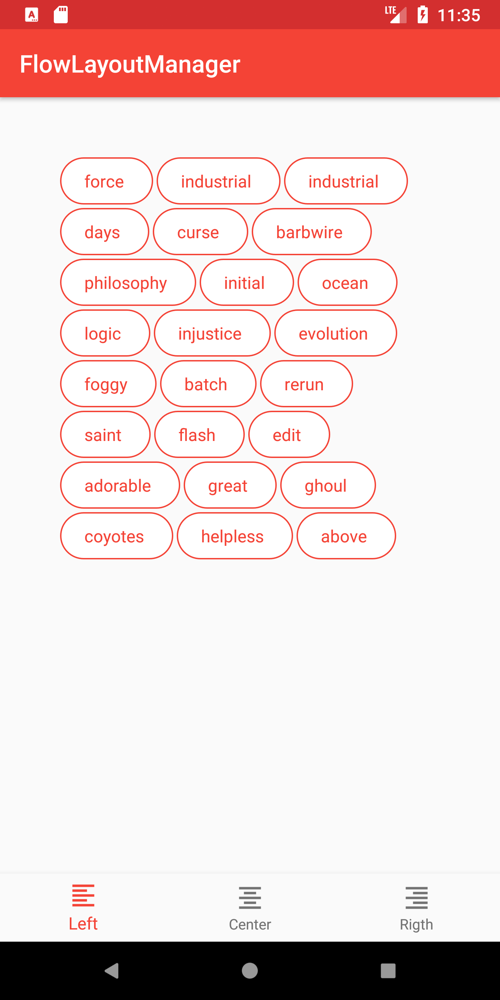
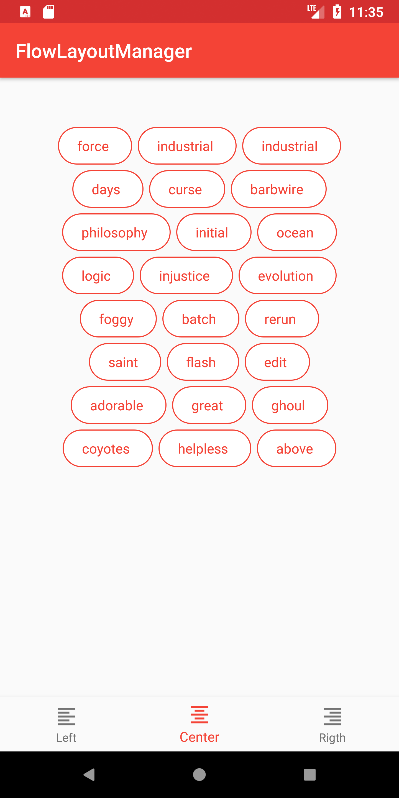
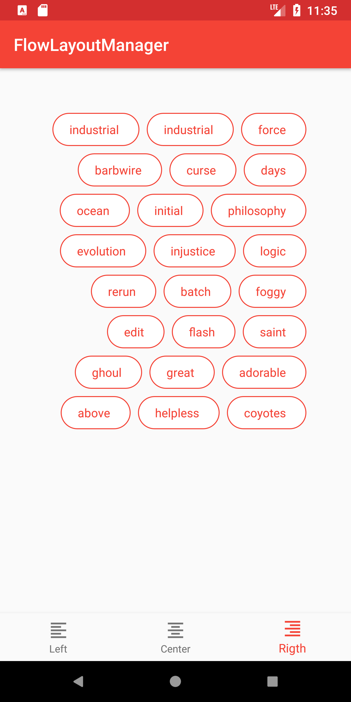

# FlowLayoutManager

[](https://github.com/simonebortolin/FlowLayoutManager/actions/workflows/ci.yml)
[](https://central.sonatype.com/artifact/io.github.simonebortolin/FlowLayoutManager)
[](https://jitpack.io/#simonebortolin/FlowLayoutManager)
[](https://developer.android.com/about/versions/lollipop)

Android 3rd party library to make implementing a FlowLayoutManager

FlowLayoutManager is a layoutManager that works with Android ___RecyclerView___ Widget, to layout views in flow style, with support of ___predictive animations___, item per line limit, max lines limit, auto measurement & alignments (left, center or right). Supports min SDK 21.

## Screenshots




## Installation

The library is published on Maven Central, add the dependency (remember to check for latest release)

```groovy
    dependencies {
        implementation 'io.github.simonebortolin:FlowLayoutManager:1.11.0'
    }
```

It is also available on [JitPack](https://jitpack.io/#simonebortolin/FlowLayoutManager) as `com.github.simonebortolin:FlowLayoutManager`
(add `maven { url "https://jitpack.io" }` to the repositories in `settings.gradle`) and on
[GitHub Packages](https://github.com/simonebortolin/FlowLayoutManager/packages) as `io.github.simonebortolin:flowlayoutmanager`, which requires a GitHub token to download.

The Javadoc of the latest release is on [GitHub Pages](https://simonebortolin.github.io/FlowLayoutManager/).

Every release also ships the `.aar`, the Javadoc `.jar` and the sample app `.apk`, with their build provenance attestation,
on the [Releases page](https://github.com/simonebortolin/FlowLayoutManager/releases).

Item per line limitation
---
Single item per line
```java
recyclerView.setLayoutManager(new FlowLayoutManager().singleItemPerLine());
```

```kotlin
recyclerView.setLayoutManager(FlowLayoutManager().singleItemPerLine())
```

or x items per line
```java
recyclerView.setLayoutManager(new FlowLayoutManager().maxItemsPerLine(x));
```

```kotlin
recyclerView.setLayoutManager(FlowLayoutManager().maxItemsPerLine(x))
```

to remove Item per line limitation
```java
((FlowLayoutManager)recyclerView.getLayoutManager()).removeItemPerLineLimit();
```

```kotlin
(recyclerView.getLayoutManager() as FlowLayoutManager).removeItemPerLineLimit()
```

Max lines limitation
---
Show at most x lines, the items that do not fit are not laid out
```java
recyclerView.setLayoutManager(new FlowLayoutManager().maxLines(x));
```

```kotlin
recyclerView.setLayoutManager(FlowLayoutManager().maxLines(x))
```

to remove max lines limitation
```java
((FlowLayoutManager)recyclerView.getLayoutManager()).removeMaxLinesLimit();
```

```kotlin
(recyclerView.getLayoutManager() as FlowLayoutManager).removeMaxLinesLimit()
```

Auto measurement
---
```java
FlowLayoutManager flowLayoutManager = new FlowLayoutManager();
flowLayoutManager.setAutoMeasureEnabled(true);
recyclerView.setLayoutManager(flowLayoutManager);
```

```kotlin
flowLayoutManager = FlowLayoutManager()
flowLayoutManager.setAutoMeasureEnabled(true)
recyclerView.setLayoutManager(flowLayoutManager)
```

Alignment
---
```java
recyclerView.setLayoutManager(new FlowLayoutManager().setAlignment(Alignment.LEFT));
```
```kotlin
recyclerView.setLayoutManager(FlowLayoutManager().setAlignment(Alignment.LEFT))
```
Alignment could be LEFT, CENTER or RIGHT.

## Credits


I thank all the authors of the various commits that I have included in my fork, in particular:

* [xiaofeng-han/AndroidLibs](https://github.com/xiaofeng-han/AndroidLibs), the original library
* [davidleen](https://github.com/davidleen/FlowLayoutManager) for the max lines limit
* [hees-k](https://github.com/hees-k/FlowLayoutManager) and [idindevelop](https://github.com/idindevelop/FlowLayoutManager) for the build updates

## Build

The project builds with Gradle 9 / AGP 9 and JDK 17:

```bash
./gradlew :flowlayoutmanager:testDebugUnitTest :flowlayoutmanager:assembleRelease :app:assembleDebug
```

Unit tests run on the JVM with [Robolectric](https://robolectric.org), so no emulator is needed; they need JDK 21 for the latest Android SDK. CI runs them on the lowest Android SDK Robolectric supports (23) and on the latest one (37), and builds the library only when they pass.

`minSdk` is set once by `MIN_SDK` in `gradle.properties` for both the library and the sample app, and it is kept as low as the dependencies allow: the sample uses only framework widgets and RecyclerView for this reason. A dependency update that requires a higher `minSdk` makes the build fail (manifest merger), so it never raises it silently.

CI builds the library AAR and the sample APK on every pull request; on `master` it also tags and releases the version set by `VERSION_NAME` in `gradle.properties` (bump it to release).


## License
	Copyright (c) 2016 xiaofeng-han
      
    Licensed under the GNU GENERAL PUBLIC LICENSE (the "License");
    you may not use this file except in compliance with the License.
    You may obtain a copy of the License at

       https://github.com/simonebortolin/FlowLayoutManager/blob/master/LICENSE

    Unless required by applicable law or agreed to in writing, software
    distributed under the License is distributed on an "AS IS" BASIS,
    WITHOUT WARRANTIES OR CONDITIONS OF ANY KIND, either express or implied.
    See the License for the specific language governing permissions and
    limitations under the License.
